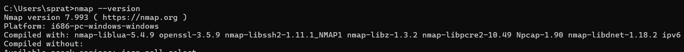
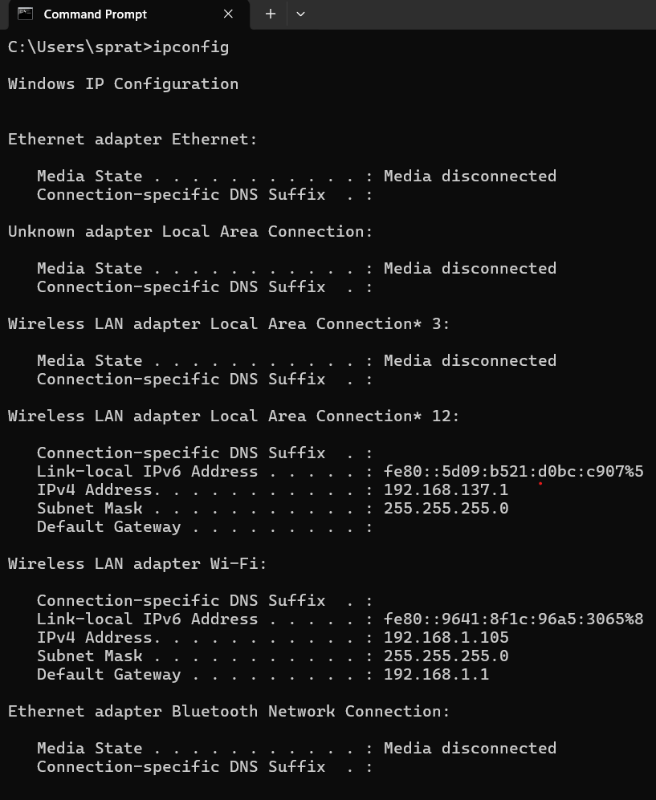
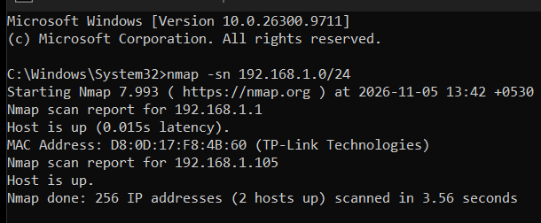
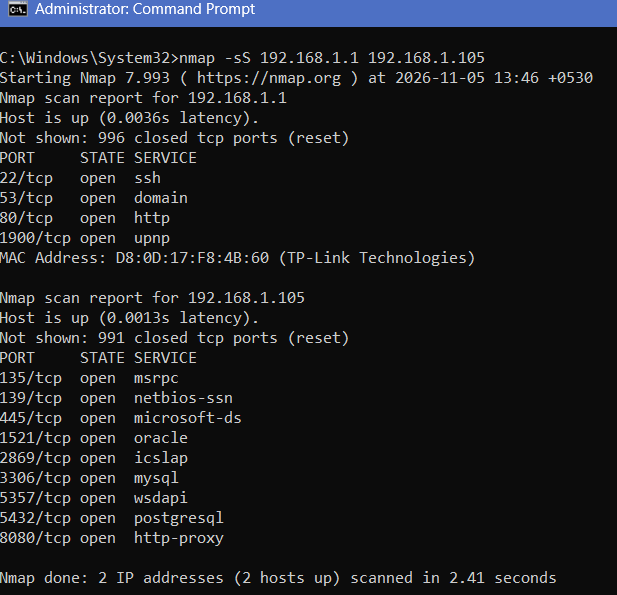
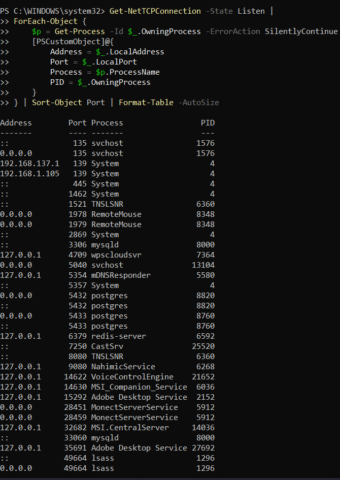
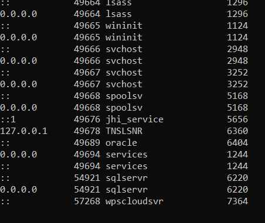

# Nmap Network Reconnaissance

## 1. Introduction

This project focuses on learning basic network reconnaissance using Nmap. It involves identifying devices and discovering open ports on an authorized local network.

## 2. Objective

To understand network scanning, identify open ports, examine network services, and learn basic network security risks.

## 3. Tools Used

- Nmap
- Npcap
- Wireshark (optional)
- Windows 11

## 4. Installation and Verification

Nmap version: 7.993  
Npcap version: 1.90

Npcap service status: RUNNING

### 4.1 Nmap Installation and Version Verification

Nmap was successfully installed on the Windows 11 system.
The installation was verified using the `nmap --version`
command in Command Prompt.

The output confirmed that Nmap version 7.993 was installed.

**Practical Evidence:**

_Figure 1: Verification of Nmap installation and version through Command Prompt._

## 5. Network Information

IPv4 Address: 192.168.1.105  
Subnet Mask: 255.255.255.0  
Default Gateway: 192.168.1.1  
Network Range: 192.168.1.0/24

### 5.1 Network Configuration Evidence

The network configuration was checked using Windows Command Prompt.
The output provided the system's IPv4 address, subnet mask and default
gateway, which were used to determine the local network range for scanning.

**Practical Evidence:**

_Figure 2: Windows network configuration showing the IPv4 address, subnet mask and default gateway._

## 6. Scanning Methodology

### 6.1 Host Discovery

**Command used:**
`nmap -sn 192.168.1.0/24`

**Purpose:**
To identify reachable devices on the local network without performing a port scan.

**Results:**

- Total IP addresses scanned: 256
- Hosts discovered: 2
- Device 1: 192.168.1.1 (TP-Link router)
- Device 2: 192.168.1.105 (Windows computer)

**Observation:**
Nmap successfully identified two reachable hosts on the local network.

**Practical Evidence:**

_Figure 3: Nmap host discovery scan identifying two reachable devices on the local network._

### 6.2 TCP SYN Scan

**Command used:**
`nmap -sS 192.168.1.1 192.168.1.105`

**Purpose:**
To identify open TCP ports on the discovered router and Windows computer using a TCP SYN scan.

**Results:**

Router (192.168.1.1):

- 22/tcp – SSH
- 53/tcp – DNS
- 80/tcp – HTTP
- 1900/tcp – UPnP

Windows Computer (192.168.1.105):

- 135/tcp – MSRPC
- 139/tcp – NetBIOS
- 445/tcp – Microsoft-DS
- 1521/tcp – Oracle (port-based service label)
- 2869/tcp – ICSLAP
- 3306/tcp – MySQL (port-based service label)
- 5357/tcp – WSDAPI
- 5432/tcp – PostgreSQL (port-based service label)
- 8080/tcp – HTTP Proxy (port-based service label)

**Observations:**

- The router had 4 open TCP ports.
- The Windows computer had 9 open TCP ports.
- Nmap reported other scanned ports as closed.
- Further investigation is required to confirm the actual applications listening on these ports.

**Scan technique:**
TCP SYN scan (-sS).

**Practical Evidence:**

_Figure 4: Nmap TCP SYN scan identifying open TCP ports on the router and Windows computer._

## 7. Scan Results

The TCP SYN scan was performed successfully on two active devices within the authorized local network. The scan identified open TCP ports and their associated service names.

### 7.1 Summary of Discovered Devices

| No. | Device Identified   | IP Address    | Status | Open TCP Ports |
| --: | ------------------- | ------------- | ------ | -------------: |
|   1 | TP-Link Router      | 192.168.1.1   | Up     |              4 |
|   2 | Windows 11 Computer | 192.168.1.105 | Up     |              9 |

### 7.2 Detailed Port Scanning Results

**Device 1: TP-Link Router (192.168.1.1)**

| Port | Protocol | Service Identified by Nmap |
| ---: | -------- | -------------------------- |
|   22 | TCP      | SSH                        |
|   53 | TCP      | Domain (DNS)               |
|   80 | TCP      | HTTP                       |
| 1900 | TCP      | UPnP (Nmap service label)  |

**Device 2: Windows Computer (192.168.1.105)**

| Port | Protocol | Service Identified by Nmap |
| ---: | -------- | -------------------------- |
|  135 | TCP      | MSRPC                      |
|  139 | TCP      | NetBIOS-SSN                |
|  445 | TCP      | Microsoft-DS               |
| 1521 | TCP      | Oracle                     |
| 2869 | TCP      | ICSLAP                     |
| 3306 | TCP      | MySQL                      |
| 5357 | TCP      | WSDAPI                     |
| 5432 | TCP      | PostgreSQL                 |
| 8080 | TCP      | HTTP-Proxy                 |

### 7.3 Scan Observations

- A total of two active devices were identified on the local network.
- The TP-Link router had four open TCP ports.
- The Windows computer had nine open TCP ports.
- A total of 13 open TCP ports were identified across both devices.
- The Windows computer exposed several database-related services, including Oracle, MySQL and PostgreSQL.
- The scan also identified network-related services such as SMB, NetBIOS and SSH.

**Note:** Service names displayed by Nmap are service-database identifications. They do not independently confirm the exact application or its security status. The TCP port 1900 result was labelled UPnP by Nmap, but this identification has not been independently confirmed.

**Scan scope:** This command used Nmap's default TCP port selection. Therefore, the results describe the ports scanned by Nmap, not necessarily every TCP port on either device.

## 8. Open Port Analysis

### 8.1 Identification of Listening Processes

**Tool:** Windows PowerShell

**Command:** `Get-NetTCPConnection -State Listen`

**Purpose:**
To identify the applications and processes associated with listening TCP ports on the Windows computer.

**Important findings:**

- Port 1521: TNSLSNR (Oracle Listener)
- Port 3306: mysqld (MySQL)
- Port 5432: postgres (PostgreSQL)
- Port 5433: postgres (PostgreSQL)
- Port 33060: mysqld (MySQL)
- Port 6379: redis-server
- Port 8080: TNSLSNR (Oracle Listener)

**Network binding observations:**

Some database services were listening on 0.0.0.0 or ::, indicating that they were bound to all IPv4 or IPv6 interfaces respectively.

Other services were bound to 127.0.0.1, meaning they were listening only on the local computer.

**Security consideration:**

Services listening on network interfaces should be reviewed to determine whether remote access is necessary and whether appropriate firewall restrictions and authentication are configured.

**Practical Evidence:**

_Figure 5: Windows PowerShell output showing TCP listening ports and their associated processes._

_Figure 6: Additional PowerShell output showing listening processes and their network bindings._

## 9. Security Risks and Recommendations

Based on the Nmap scan results and Windows listening-process analysis, several network services were identified that require security consideration.

An open port does not necessarily indicate a security vulnerability. However, unnecessary or improperly configured network services may increase the attack surface of a device.

### 9.1 Potential Security Risks

**1. Remote Administration Services (SSH – Port 22)**

- SSH was identified as an open port on the TP-Link router.
- If remote administration is enabled unnecessarily or weak authentication is used, unauthorized access may become possible.
- Recommendation: Disable remote SSH access if it is not required and use strong authentication.

**2. File Sharing Services (Ports 139 and 445)**

- NetBIOS and SMB-related services were identified on the Windows computer.
- Improperly configured file sharing may expose sensitive files or allow unauthorized network access.
- Recommendation: Disable unnecessary file-sharing services and restrict SMB access using Windows Firewall.

**3. Database Services (Ports 1521, 3306 and 5432)**

- Oracle, MySQL and PostgreSQL-related services were identified.
- The PowerShell investigation also confirmed database processes listening on network interfaces.
- Unrestricted database access may expose sensitive information or allow unauthorized database operations.
- Recommendation: Restrict database connections to trusted systems, enforce strong authentication and avoid exposing database services unnecessarily.

**4. HTTP Service (Port 80)**

- An HTTP service was identified on the router.
- HTTP communication does not encrypt data exchanged between the browser and the server.
- Recommendation: If the service is used for router administration, use HTTPS whenever supported and avoid managing the router over untrusted networks.

**5. Service Labelled UPnP (TCP Port 1900)**

- Nmap identified TCP port 1900 with the service label UPnP.
- This identification does not independently confirm that UPnP functionality is active.
- Recommendation: Review the router's UPnP settings and disable the feature if it is not required.

**6. Additional Database and Remote-Control Services**

- PostgreSQL was also listening on port 5433.
- MySQL was listening on port 33060.
- Redis was listening on port 6379, bound to the localhost address.
- RemoteMouse was listening on ports 1978 and 1979.
- Recommendation: Review which applications require network access and restrict unnecessary services to trusted interfaces.

### 9.2 General Security Recommendations

1. Disable unnecessary network services and open ports.
2. Configure Windows Firewall to restrict inbound connections.
3. Use strong passwords and appropriate authentication for database services.
4. Restrict database access to trusted IP addresses.
5. Keep Windows, Nmap and installed applications updated.
6. Review router administration and UPnP settings.
7. Regularly monitor listening ports and investigate unexpected services.
8. Avoid exposing development databases and remote-control applications to untrusted networks.

### 9.3 Security Assessment

The scan identified multiple network services on the router and Windows computer. The listening-process analysis provided additional information about the applications associated with several ports.

These findings highlight the importance of limiting unnecessary network exposure, applying appropriate firewall rules and securing services through proper configuration.

No confirmed security vulnerabilities were established through this basic port-scanning exercise. Further testing would be required to assess the actual security of the identified services.

## 10. Conclusion

This project provided practical experience in using Nmap for basic network reconnaissance on an authorized local network.

The host discovery scan identified two active devices: a TP-Link router and a Windows 11 computer. The TCP SYN scan identified 13 open TCP ports across these devices. Windows PowerShell was also used to investigate listening processes and understand which applications were associated with several ports.

The exercise helped develop an understanding of host discovery, TCP SYN scanning, open ports, network services and the importance of securing exposed services.

It also highlighted that an open port does not automatically indicate a vulnerability. Further security testing is necessary to determine whether a service is vulnerable or improperly configured.

Overall, the project strengthened practical knowledge of network reconnaissance and basic network security assessment using Nmap.
